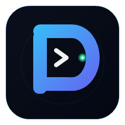

# PLAIN Language Support for Visual Studio Code

Official VS Code package for the **PLAIN Programming Language** (`.plain`).



## Features

### 🎨 Vibrant Syntax Highlighting
- Full grammar support for `Set ABC = Main`, variables, numbers, strings, and standard operators (`+`, `-`, `*`, `/`, `**`, `//`, `=`, `==`, `!=`).
- Dedicated color tokens for Cybersecurity (`cyber.*`), AI/Neural Networks (`neural_network`, `train_ai`), and HTTP servers (`web_server`).
- Python-style function definitions (`def ...:`) and classic PLAIN block syntax (`function ... end`).

### 💡 IntelliSense Autocomplete
- Context-aware code completion for 1,327+ standard library functions and keywords.
- Dynamic scanning of local variables and user-defined functions in the open document.

### 📖 Hover Documentation
- Hover over any keyword, standard function (`say`, `str`, `int`, `neural_network`, `cyber.port_scan`), or `Set ABC = Main` to view signatures, descriptions, and runnable examples.

### 🔍 Real-Time Linter & Diagnostics
- Instant detection of unclosed quotes, bracket mismatches, and legacy UTF-8 BOM encoding.
- Red squiggly lines directly in the editor with problem summaries in the VS Code **Problems** tab.

### 🚀 Integrated Code Runner
- **Run Button in Title Bar**: Click `▶ Run PLAIN File` at the top right of any `.plain` editor.
- **Keyboard Shortcut**: Press <kbd>F5</kbd> to execute the active `.plain` script in the integrated terminal.
- **Context Menu**: Right-click anywhere in the editor and choose **Run PLAIN File** or **Open in PLAIN Code Studio**.

### 🛡️ Cybersecurity & AI Tools
- Run instant security audits directly from the Command Palette (`Ctrl+Shift+P` -> `PLAIN: Run PLAIN Cybersecurity Audit`).
- Launch the native desktop IDE anytime with `PLAIN: Open in PLAIN Code Studio (Native IDE)`.

### ⚡ Snippets
- `starter` / `plain` -> Starter template with `Set ABC = Main`
- `cyber_portscan` -> TCP port scanning snippet
- `cyber_audit` -> HTTP security headers analysis
- `cyber_cve` -> Offline CVE vulnerability lookup
- `ai_nn` -> Multi-layer neural network training
- `webserver` -> Live HTTP server deployment
- `def` / `fn` / `if` / `while` / `repeat` / `for` -> Language control blocks

---

## Installation

### Instant One-Click Install
```bash
code --install-extension plain-language-support-1.3.0.vsix
```

### Build from Source
```bash
cd editors/vscode
npm run compile
npx @vscode/vsce package
```
